*A from-scratch explanation of multi-agent RL from collective rewards.*

I trained a small model, LFM2.5-2.6B, to work as a team: one lead agent that sees the question but none of the data, and two to four worker agents that each hold one piece of the data. The team gets a single score, whether its final answer was right, and every agent learns from that same score. I ran the training twice on one consumer GPU, once training every agent and once training only the lead, and compared the two. The setup is inspired by General Reasoning's [Avalon-M1 technical report](https://www.gr.inc/avalonm1.pdf), which trains agent teams this way at a much larger scale.

What I found:

- **Training the whole team works.** Team accuracy on held-out tasks rose from 22.5% to 37.5% in 30 steps (about three and a half hours), and the team got about a quarter faster.
- **Training only the lead doesn't.** Accuracy ended roughly where it started (30% → 27.5%), and 4-site teams dropped to 0%.
- **The workers were the bottleneck.** With every agent trained, workers ran out of turns half as often. With only the lead trained, they barely changed, and a better lead couldn't make up for them.
- **Worker skills carry over to working alone.** Because every agent shares the same weights, the model got better as a solo agent (45% → 62.5%) without ever being trained solo.

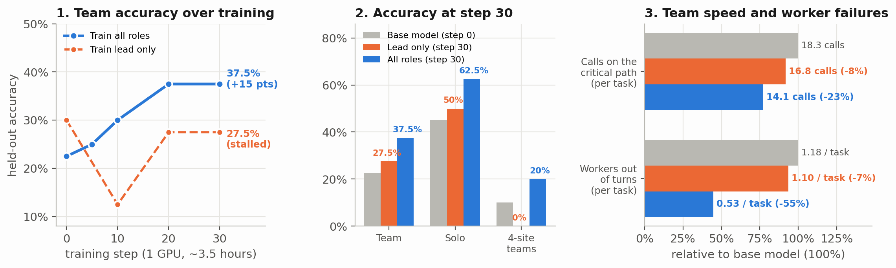

If you already know how multi-agent RL and GRPO work, skip to [C. The experiment](#c-the-experiment) or the [appendix (H)](#h-appendix).

## A. What is multi-agent RL?

### A.1 Why train a team at all?

Most RL for agents trains one agent at a time: one model in one loop, opening files, running code, and giving an answer. But a lot of real systems split the work up. An orchestrator breaks the problem into pieces, hands each piece to a sub-agent with its own context and tools, waits for the replies, and puts the answer together.

If you want to train a system like that, the task has to actually need a team. If one agent could just read all the files itself, talking to other agents is pure overhead and there's nothing to learn about working together. So I built tasks where no single agent has enough information to answer on its own.

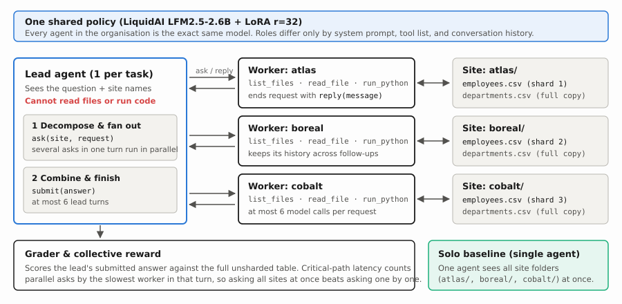

Each task is a question about a small company dataset: orders, employees, or website sessions. The main table is split by rows across 2 to 4 "sites", and the split is uneven, so one site can easily have twice as many rows as another. Small lookup tables, like the list of departments, are copied to every site.

Here's a real test task:

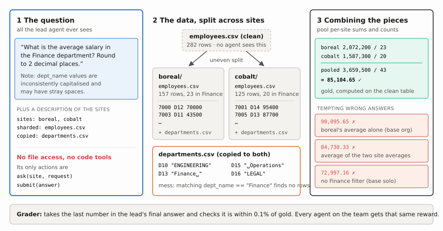

There are three kinds of agent:

- **The lead** sees the question, the list of sites, and which file is split and which is copied. It can't read files or run code. All it can do is ask a site something or submit an answer. If it asks several sites in the same turn, they work in parallel.
- **The workers**, one per site, each live in their own sandboxed folder and can't see the other sites. A worker can list its files, read one, run Python, and send a reply. It remembers its conversation, so the lead can come back with a follow-up question.
- **The solo agent** is only used for evaluation. It's the same model working alone, with every site's folder in one workspace and the same tools a worker has. It has all the information and doesn't need to talk to anyone.

### A.2 Why splitting the data forces real coordination

Because the rows are split unevenly, the lead can't just forward the question to every worker and average what comes back.

- For an average, a percentage, or a ratio, it needs each site's sum and count, not each site's average.
- For "which one is biggest" questions, like the best-selling product, it needs every site's full breakdown, because the winner at one site isn't necessarily the winner overall.
- For "how many distinct" questions, it needs the actual IDs, because the same customer can show up at more than one site.

Here's the Finance task from above, played out three ways: by the untrained team, by the trained team, and by the model working solo.

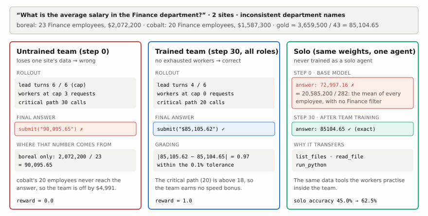

The right answer combines both sites: 3,659,500 / 43 = 85,104.65. Before training, the team answers 90,095.65, which is boreal's Finance average on its own. Cobalt's 20 Finance employees never make it into the answer: three worker requests run out of turns, and the lead uses up all six of its own. After training, the team finishes in four lead turns, no worker runs out of turns, and it answers \$85,105.62, which is close enough to pass. Working solo, the trained model gets 85,104.65 exactly, while the untrained solo model averaged all 282 employees and forgot to filter to Finance.

### A.3 How hard are these tasks?

Before looking at any training curves, it's worth asking whether these tasks are actually hard for a 2.6B model. If they were easy, the base model would start high and there'd be little left to learn.

They are hard. The untrained team gets only 22.5% of test tasks right, and just 1 in 10 of the 4-site ones. During training, about 38% of groups had all six teams score the same, mostly because all six failed. Even after training, the hardest questions stay around 25%.

The difficulty comes from three layers stacked on top of each other:

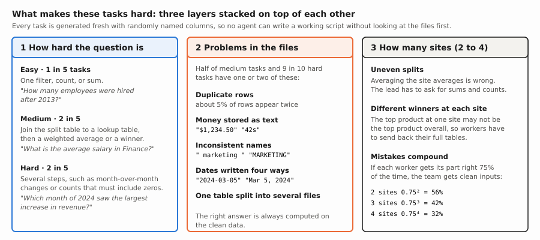

1. **The question itself.** Easy questions (1 in 5) are a single filter, count, or sum. Medium questions (2 in 5) join the split table to a lookup table and then compute something like a weighted average. Hard questions (2 in 5) take several steps, like finding the biggest month-over-month jump in revenue. Every task is generated fresh with randomly named columns (a date column might be `order_date`, `date`, or `OrderDate`), so a worker has to look at the file before it can write any code.
2. **Problems in the files.** Half of the medium tasks and 9 in 10 of the hard ones have one or two problems in the data: duplicate rows, money stored as text like "\$1,234.50", names with inconsistent capitalisation and stray spaces, dates written four different ways in the same column, or one table split across several files. The right answer is always computed on the clean data, so a worker that doesn't notice the problem reports the wrong number.
3. **More sites.** Every extra site is another worker that can get something wrong, and the mistakes compound. If each worker gets its part right 75% of the time, a 2-site team gets clean inputs 56% of the time, and a 4-site team only 32%.

**Why does solo score higher than the team?** Solo gets 45% before training and 62.5% after, against the team's 22.5% and 37.5%. That's expected. The split here is about access, not size: think of data held at separate sites where no single agent is allowed to see everything, even though it would all fit in one context window. So when the solo agent is handed every folder, it skips all the communication and does better. That makes solo a useful test. The model is never trained solo, so any improvement there has to come from skills it picked up as a worker.

### A.4 One model plays every role

Do the lead and the workers get separate weights? No. Following [Avalon-M1](https://www.gr.inc/avalonm1.pdf), every agent is the same model, $\pi_\theta$. Nothing in the weights says "I'm the lead" or "I'm the worker at atlas"; roles exist only in the prompt and the tools each call gets. Avalon-M1 describes the shared weights $\theta$ as a **gene pool**: every role draws from them during a rollout, and whatever any role learns flows back into the same parameters.

That gives us something to test. If the workers get better at reading and cleaning data inside a team, the same model should get better at working alone, because the solo agent uses exactly the same tools.

## B. How RL from Collective Rewards (RLCR) works

**RLCR runs the whole team, grades only the final answer, and gives every agent on the team that same grade.**

### B.1 A team rollout

One attempt at a task by the organisation results in a **team rollout** $\tau = (\tau_{\text{lead}}, \tau_{\text{atlas}}, \tau_{\text{boreal}}, \dots)$: $1 + K$ conversations, one per agent. Every token comes from the same model; agents differ only in their context $c_{a,t}$ (system prompt, tools, own history, and messages from other agents):

$$
y_{a,t} \sim \pi_\theta(\,\cdot \mid c_{a,t}\,),
\qquad
\log \pi_\theta(\tau) \;=\; \sum_{a \,\in\, \text{team}} \; \sum_{t} \log \pi_\theta(y_{a,t} \mid c_{a,t})
$$

The same $\theta$ appears in every term, so training on *any* agent's tokens changes the model for *every* role.

### B.2 The collective reward

When a team gets the wrong answer, whose fault was it? The lead might have asked for local averages instead of sums and counts, one worker might have skipped deduplication, and another might have hit its turn limit. A judge model that hands out individual blame is brittle and easy to game: workers learn to write confident replies that please the judge. <u>RLCR grades only the outcome</u>:

$$
r(\tau) \;=\; \mathbb{1}[\text{answer correct}] \;=\;
\begin{cases}
1 & \text{if the lead's final answer matches the gold answer} \\
0 & \text{otherwise}
\end{cases}
$$

To grade, we take the last number in the lead's final message and compare it with the gold answer, which is computed on the clean, unsharded data. We accept it if it is within 0.1% of gold. That tolerance absorbs harmless rounding differences, such as rounding a sum before dividing, but it still rejects a wrong method. On the Finance task, the 0.1% window is gold ± \$85: the trained team's 85,105.62 (off by \$0.97) passes, while the average of the two site averages (84,730.33, 0.44% off) and boreal's average alone (90,095.65, 5.9% off) both fail.

Then **every agent on the team receives that same $r(\tau)$**: the lead, the worker who did everything right, and the worker who ran out of turns without ever replying. On the Finance task above, all three agents of the base team get $r = 0$ and all three agents of the trained team get $r = 1$.

### B.3 The speed bonus: critical-path latency

A pure right/wrong reward can't tell a team that asks its workers one at a time from one that asks them all at once. Avalon-M1 handles time with a wall-clock limit; here it becomes a small bonus.

**Measuring time.** Think of a stopwatch that ticks once per model call, except that workers asked in the same turn run in parallel, so their calls tick *together* and the team only waits for the slowest one. The final count is the number of model calls on the **critical path**, written $L_{\text{crit}}$.

Here's a small two-site example, like the Finance task:

| Lead turn | What happens | Ticks |
|---|---|---|
| 1 | The lead asks `boreal` and `cobalt` in the same message (1 call). `boreal`'s worker lists its files, runs a script, and replies (3 calls). At the same time, `cobalt`'s worker runs a script and replies (2 calls). The team waits for the slower one. | $1 + \max(3, 2) = 4$ |
| 2 | The lead asks `cobalt` a follow-up (1 call); `cobalt` replies from what it already computed (1 call). | $1 + 1 = 2$ |
| 3 | The lead submits the answer (1 call). Nobody is asked. | $1$ |
| | **Critical-path latency** | $L_{\text{crit}} = 7$ |

The team made 9 model calls in total, but `cobalt`'s 2 calls in turn 1 overlapped `boreal`'s 3, so the clock reads 7. If the lead had instead asked `boreal` in turn 1 and `cobalt` in turn 2, the same work would cost $(1 + 3) + (1 + 2) + 2 + 1 = 10$. That difference is exactly what the speed bonus rewards.

In general, each lead turn costs 1 plus the calls $n_{s,t}$ of the slowest site $s$ asked in that turn:

$$
L_{\text{crit}}(\tau) \;=\; \sum_{t=1}^{T_{\text{lead}}} \Big(1 \;+\; \max_{s \,\in\, \text{asked}(t)} n_{s,t}\Big)
$$

**Turning time into a score.** Map latency to a score between 0 and 1 with a straight line between two reference points:

$$
\text{speed}(L) \;=\; \mathrm{clip}\!\left(\frac{L_{\text{slow}} - L}{L_{\text{slow}} - L_{\text{fast}}},\; 0,\; 1\right)
\;=\; \mathrm{clip}\!\left(\frac{18 - L}{14},\; 0,\; 1\right)
$$

- **$L_{\text{fast}} = 4$ is the fastest plausible solve:** the lead asks every site (1 call), each worker runs one script and replies (2 calls, in parallel), and the lead submits (1 call).
- **$L_{\text{slow}} = 18$ is a slow solve:** the lead's 6-turn limit plus two worker requests that each hit the 6-call limit, $6 + 2 \times 6$.
- **14** is the width of that window, $18 - 4$, and $\mathrm{clip}$ keeps the score in $[0, 1]$ for teams faster than 4 or slower than 18.

**The full reward** is:

$$
r(\tau) \;=\; \underbrace{\mathbb{1}[\text{answer correct}]}_{\text{0 or 1}} \cdot \Big(1 \;+\; \underbrace{0.1 \cdot \text{speed}\big(L_{\text{crit}}(\tau)\big)}_{\text{between 0 and 0.1}}\Big)
$$

Correctness *multiplies* the bonus, so a wrong answer is worth 0 however fast it was, and nothing can be earned by guessing quickly. The 0.1 keeps speed a tie-breaker: correct teams score between 1.0 and 1.1, so speed only ranks teams that were already right.

| Outcome | $L_{\text{crit}}$ | $\text{speed}(L)$ | $r$ |
|---|---|---|---|
| Wrong answer | any | — | $0$ |
| Correct, fastest plausible | $4$ | $1$ | $1.100$ |
| Correct, asked both sites at once (example above) | $7$ | $11/14 = 0.79$ | $1.079$ |
| Correct, asked sites one at a time (example above) | $10$ | $8/14 = 0.57$ | $1.057$ |
| Correct but slow (the trained Finance team) | $20$ | $0$ | $1.000$ |

Over many tasks, that small gap teaches the lead to fan out in one turn and each worker to answer with one clean script instead of becoming the bottleneck.

### B.4 Group-relative advantages

As in GRPO, each training question is attempted by $G = 6$ independent organisations, and each team's reward is normalised within its group:

$$
A_g = \frac{r_g - \bar r}{\sigma_r + 0.05}
$$

where $\bar r$ and $\sigma_r$ are the group's mean and standard deviation, and the $+0.05$ keeps near-identical scores from producing huge advantages.

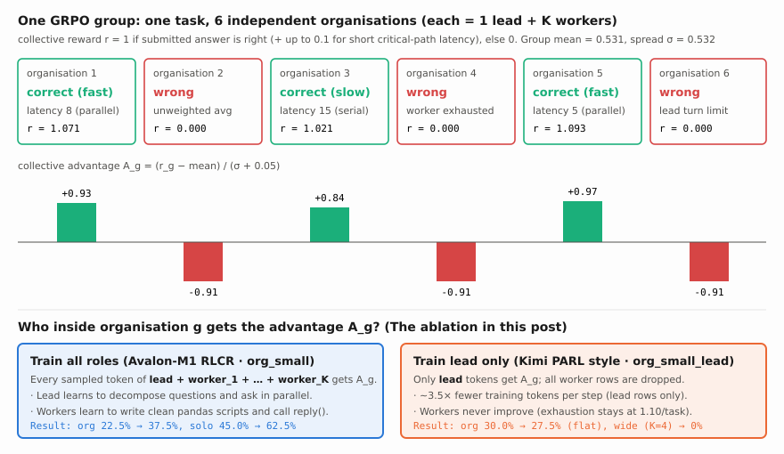

In the figure, the three correct teams get $+0.97$, $+0.93$, and $+0.84$ (fastest to slowest) and each wrong team gets $-0.91$, so the speed bonus shows up as the spread between winners. Groups where all six teams score the same carry no signal and are dropped; in our runs that was 38% of groups, mostly tasks where all six teams failed.

### B.5 One advantage for every agent's tokens

Team $g$'s single advantage $A_g$ is copied onto every token that its agents wrote. The loss, restricted to a set of trained roles $R$, is:

$$
\mathcal{L}_R(\theta) \;=\; -\frac{1}{N} \sum_{g=1}^{G} A_g \sum_{\substack{a \,\in\, \text{team } g \\ \text{role}(a) \,\in\, R}} \; \sum_{t} m_{a,t}\, w_{a,t}\, \log \pi_\theta(y_{a,t} \mid c_{a,t})
$$

- **$A_g$ sits outside the agent sum**, so the lead and every worker on team $g$ share it. This is the whole of RLCR.
- **$m_{a,t} \in \{0, 1\}$** masks in only the tokens agent $a$ sampled itself, not prompts, tool outputs, or messages from other agents.
- **$w_{a,t} = \min\big(\pi_\theta / \mu,\ 2\big)$** corrects for small numerical differences between vLLM ($\mu$), which sampled the tokens, and the trainer. It stays close to 1 (see [H.5](#h5-training-health-and-vllm-to-trainer-kl-verification)).
- **$N$** is the number of trained tokens in the batch.

The role set $R$ is the knob this post turns. $R = \{\text{lead}, \text{worker}\}$ is full RLCR, as in Avalon-M1. $R = \{\text{lead}\}$ trains only the orchestrator, in the style of Kimi's PARL: workers still run on the live shared weights, but their tokens are dropped from the loss. Same rollouts, same rewards, same advantages; only the tokens the gradient sees differ.

## C. The experiment

**Does a team need every agent trained, or is it enough to train the lead?**

### C.1 Two runs, one difference

Published systems disagree on this. Avalon-M1 trains every agent on the team; Kimi's PARL trains only the orchestrator. Training only the lead is appealing because it's cheaper, and the lead is the one making the decisions. But if the workers are sloppy, a better lead might not help much.

To find out, I trained the same model twice from the same starting weights. Both runs see the same tasks in the same order, roll out teams the same way, and compute the same rewards and advantages. The only thing that changes is the role set $R$ from [B.5](#b5-one-advantage-for-every-agents-tokens), which decides whose tokens the loss sees.

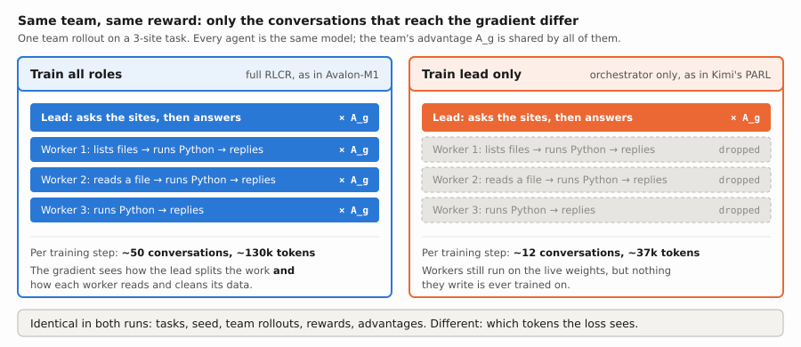

- **Train all roles.** The lead's conversation and every worker's conversation go into the loss. That's about 50 conversations and 130k tokens per training step.
- **Train the lead only.** The workers still do their jobs on the latest weights, but their conversations are thrown out before the backward pass. That leaves about 12 conversations and 37k tokens per step. Workers write roughly three-quarters of a team's tokens, so this discards most of the data. It also makes each backward pass about three times faster.

### C.2 Setup

Everything runs on a single 24 GB RTX 3090 Ti, shared between vLLM, which generates the rollouts, and the trainer. The model is LFM2.5-2.6B, trained with a rank-32 LoRA. The same weights play the lead, every worker, and the solo agent.

Each training step draws 4 tasks and has 6 teams attempt each one, for 24 team rollouts per step. Each run is 30 steps, which comes to 120 tasks and 720 team rollouts in about three and a half hours. Rollouts are sampled at temperature 1.0 and evaluations at 0.7. I evaluated both runs at steps 0, 10, 20, and 30, and the whole-team run also at step 5. The single-GPU details are in the [appendix](#h-appendix).

### C.3 Training and test tasks

Training questions come from retail and HR data split across 2 or 3 sites. Two in five are hard, two in five medium, and one in five easy. Over half have messy files: duplicate rows, money stored as text like "\$1,234.50", inconsistent capitalisation, mixed date formats, or one table split into several files.

The test set has 40 tasks in four groups of 10. Each group is harder to reach from the training data than the last. Every task is attempted twice per evaluation, once by the team and once by a single solo agent, which gives 80 attempts per checkpoint.

| Test group | Sites | What's new | Example |
|---|---|---|---|
| **Seen** | 2–3 | nothing but the data | *"What is the average salary in the Finance department?"* |
| **New questions** | 2–3 | question types never trained on | *"Which month of 2024 saw the largest increase in revenue over the previous month?"* |
| **New domain** | 2–3 | website-session data instead of retail or HR | *"What percentage of all sessions were on mobile devices?"* |
| **Wider teams** | **4** | more workers than the lead ever managed in training | *"How many employees were hired after 2013?"* |

## D. Results

**Training the whole team works. Training only the lead doesn't, because on a small model the workers are the weak link.**

The full result tables are in the [appendix](#h7-held-out-accuracy-by-step-and-test-bucket).

### D.1 The whole team gets better; the lead alone doesn't

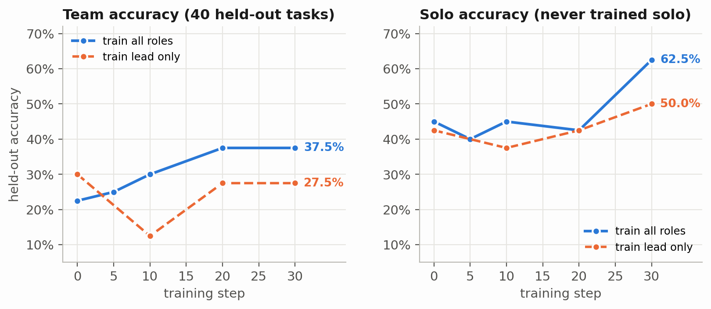

When I trained every role, the team got steadily better: accuracy on held-out tasks went from 22.5% to 37.5% over 30 steps. It wasn't just getting better at questions it had already seen, either. It also improved on new kinds of questions, on website data it had never seen, and on 4-site teams, which are bigger than any team it trained with.

Training only the lead didn't really go anywhere. Accuracy dropped in the middle of the run, came back, and finished roughly where it started (27.5%, against 30% at the beginning).

The result I didn't expect is on the right. Neither run ever trained the model to work on its own, but when the workers were trained, the solo agent jumped from 45% to 62.5%. With only the lead trained, it reached 50%. Forty tasks per mode is a small test, so I wouldn't lean on any single point, but across all 80 attempts the whole-team improvement is statistically significant ($p = 0.024$) and the lead-only change isn't.

*(The two runs start from identical weights. Their step-0 scores differ only because evaluation samples at temperature 0.7.)*

### D.2 Why: the workers were the bottleneck

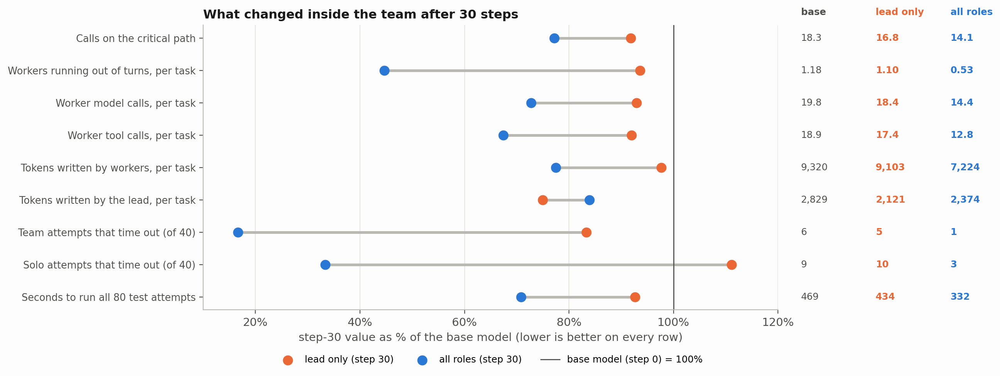

Looking inside the team explains most of it. When only the lead was trained, the workers behaved almost exactly like the base model. They still ran out of turns about once per task, made nearly as many calls, and wrote nearly as many tokens. The lead may well have learned to ask better questions, but the answers it got back were no better, so the team didn't improve.

When every role was trained, the workers changed. Instead of poking around until they ran out of turns, they would look at the file, write one script that worked, and reply. They ran out of turns half as often, the team needed about a quarter fewer calls on its critical path, and only 1 of the 40 team attempts timed out, compared with 6 before training.

The solo result follows from this. A solo agent uses the same tools as a worker: it lists the files, reads them, and runs Python. So every bit of practice a worker gets is also practice for working alone, and if only the lead is trained, those skills never get updated. The solo timeouts show it: they dropped from 9 to 3 when the workers were trained, and went from 9 to 10 when they weren't.

This is probably why training only the orchestrator works in papers like Kimi's PARL. They use frontier-scale models whose sub-agents can already run a bit of Python reliably. A 2.6B model can't, so its workers need training too.

### D.3 Where it helped, and why 4-site teams are the hardest test

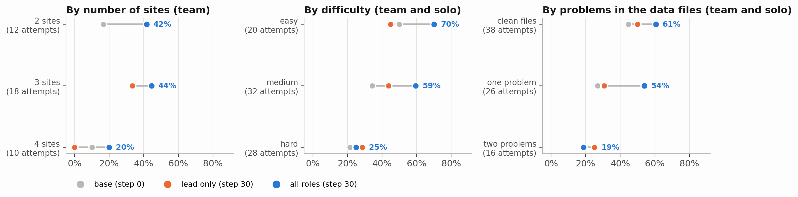

Most of the gain came from easy and medium questions, and from files that were either clean or had a single problem, such as duplicate rows or prices stored as text. The hardest questions, and files with two problems at once (say, duplicate rows *and* inconsistent capitalisation), stayed under 30% in both runs. Thirty steps wasn't enough to crack those.

The 4-site teams show the biggest difference. Training every role doubled their accuracy from 10% to 20%, while training only the lead dropped it to zero. That makes sense once you think about how mistakes compound. If each worker has a 75% chance of doing its part right, a 2-site team gets all-correct inputs about 56% of the time ($0.75^2$), but a 4-site team only about 32% of the time ($0.75^4$).

Here's what that looks like on a real question: *"How many employees were hired after 2013?"* The answer is 156. The team trained on every role asks all four sites at once, gets back 28, 32, 19, and 77, adds them up, and answers.

The lead-only team gets exactly the same four numbers, and all four are correct. The trouble is how the workers report them. They describe their local counts as totals "across all sites", and one of them backs up its 77 with a year-by-year breakdown that only adds up to 53. The lead can't see the files, so it has no way of knowing which reply to trust. It spends thousands of tokens wondering whether the sites share data, adds the numbers up wrong (154), and never commits to an answer.

So the lead had every number it needed. What it was missing was workers that report clearly, and training only the lead can't fix that.

### D.4 How much to trust this

This is a small experiment, so take the numbers with a grain of salt. Each mode has 40 test tasks, so a single task moves a 10-task group by 10 points, and only the pooled 80-attempt comparison for whole-team training is clearly significant. I ran each setting once, with one seed. Each run is also only 30 steps (about three and a half hours), and the whole-team run hadn't obviously levelled off, so longer training could change the picture. Finally, a logging bug crashed the main run just after its final weights were saved; the final evaluation used those saved weights, so the results aren't affected.

## E. Conclusion

**A shared reward is a good place to start.** Working out which agent deserves credit for a team's success is hard, and a judge that tries to assign blame is easy to game. Grading only the final answer, giving every agent that same grade, and comparing teams that tried the same question sidesteps the problem. It's crude, but it gives a usable learning signal even for a small model on a single GPU.

**Train the agents that do the work, not just the one giving orders.** An orchestrator is only as good as the answers it gets back. If the sub-agents are already strong, training the orchestrator alone may be enough. If they aren't, as with small models, they need training too, and the bigger the team, the more that matters.

**One model playing many roles shares what it learns.** When the same weights play every role, skills picked up in one role carry over to the others, including working alone. That makes a multi-agent setup a way to train a better single agent, not just a better team.

**Measure time the way the team experiences it.** Counting the calls along the critical path, rather than every call, rewards agents for working in parallel without penalising a team for being large.

## F. Code

Everything is on GitHub at [sol0invictus/multi_agent_rl_demo](https://github.com/sol0invictus/multi_agent_rl_demo): the sharded task generator, the lead/worker/solo harnesses, the RLCR trainer (GRPO + LoRA on one GPU), the logs from both runs, and the scripts that rebuild every figure in this post. The README walks through the design, and `make test` runs an end-to-end check without a GPU.

## G. References

1. General Reasoning. *Avalon-M1* technical report, 2026. [gr.inc/avalonm1.pdf](https://www.gr.inc/avalonm1.pdf). The source of RLCR and the "one set of weights as a gene pool" framing.
2. Kimi Team. *Kimi K2.5: Visual Agentic Intelligence*. arXiv:2602.02276, 2026. [arxiv.org/abs/2602.02276](https://arxiv.org/abs/2602.02276). Introduces PARL, which trains only the orchestrator and keeps sub-agents frozen.
3. Z. Shao et al. *DeepSeekMath: Pushing the Limits of Mathematical Reasoning in Open Language Models*. arXiv:2402.03300, 2024. [arxiv.org/abs/2402.03300](https://arxiv.org/abs/2402.03300). Introduces GRPO.
4. E. J. Hu et al. *LoRA: Low-Rank Adaptation of Large Language Models*. ICLR 2022. [arxiv.org/abs/2106.09685](https://arxiv.org/abs/2106.09685).
5. W. Kwon et al. *Efficient Memory Management for Large Language Model Serving with PagedAttention* (vLLM). SOSP 2023. [arxiv.org/abs/2309.06180](https://arxiv.org/abs/2309.06180).
6. Liquid AI. *LFM2.5-2.6B* model card. [huggingface.co/LiquidAI/LFM2.5-2.6B](https://huggingface.co/LiquidAI/LFM2.5-2.6B).
7. Q. McNemar. *Note on the sampling error of the difference between correlated proportions or percentages*. Psychometrika 12(2), 153–157, 1947. The paired test used for the significance numbers.

## H. Appendix

Running multi-agent RL with 24 concurrent organisations (72–96 agents per step) plus a live vLLM server and a PyTorch trainer on a single 24 GB GPU requires several systems choices that sit underneath the RL loop.

### H.1 The token-capturing proxy (`proxy.py`) and append-only stitching (`rollout.py`)

The agent harnesses in `agents.py` never touch PyTorch or tokenizers. Each agent in rollout `rid` is handed its own OpenAI-compatible URL—`http://127.0.0.1:8100/r/<rid>-lead/v1`, `/r/<rid>-atlas/v1`, `/r/<rid>-boreal/v1`—pointing at `CaptureProxy` (`proxy.py`):

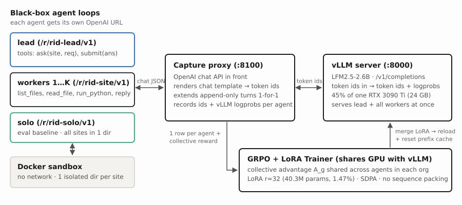

The proxy renders each agent's chat messages with the model's chat template, forwards the **exact token IDs** to vLLM's `/v1/completions`, and records `(prompt_ids, completion_ids, vllm_logprobs)` under that agent's ID.

Because neither the lead nor the workers ever compact or rewrite their history, every new turn of an agent extends its previous turn token-for-token (`proxy.n_extended`). At the end of the rollout, `to_rows` stitches each agent's calls into **one training row**, so a 3-site organisation becomes 4 rows (1 lead row + 3 worker rows):

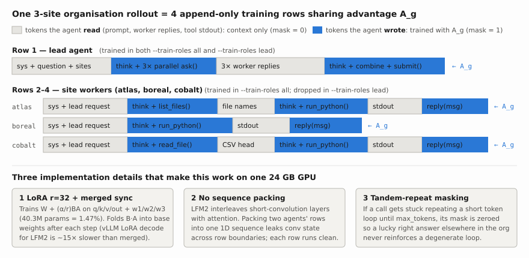

The trainer then minimizes the truncated importance-sampling policy gradient loss over all sampled tokens (`mask = 1`) in the selected roles:

$$
\mathcal{L}(\theta) \;=\; -\frac{1}{N}\sum_{a \in \text{roles}} \sum_{t:\, m_{a,t}=1} \min\!\Big(\frac{\pi_\theta(y_{a,t})}{\mu(y_{a,t})},\, 2\Big)\, A_g \,\log \pi_\theta(y_{a,t})
$$

### H.2 Three LFM2 and vLLM quirks on one GPU

1. **Merged-weight sync.** Normally you would keep the base model in vLLM and hot-swap the 80 MB LoRA adapter each step (see [H.6](#h6-lora-parameterization-and-memory-budget-on-one-24-gb-gpu)). On this machine, vLLM's LoRA decode path for `LFM2.5-2.6B` is about **15× slower** than base-model decode. So after every gradient step, `publish_merged` folds the LoRA update $\frac{\alpha}{r}BA$ into the base weights in memory, writes `policy/model.safetensors`, and hits vLLM's `/collective_rpc` (`reload_weights`) plus `/reset_prefix_cache`. Reloading the 5 GB file takes ~2 seconds and keeps generation at full speed.
2. **No sequence packing across agents.** `LFM2.5-2.6B` is a hybrid architecture that interleaves gated short-convolution (`Lfm2ShortConv`) layers with SDPA attention layers. If you pack two different agents' rows into a single 1D sequence to save padding, the short-conv kernel leaks state across the boundary between agent 1 and agent 2. Every agent row is therefore forwarded as its own clean sequence with activation checkpointing.
3. **Tandem-repeat masking (`tandem_repeat`).** In a multi-agent rollout, one worker can occasionally get stuck repeating a short phrase until it hits `max_tokens`, while the rest of the organisation still manages to guess or compute the right answer. Without protection, a positive collective advantage $A_g > 0$ would reinforce the degenerate loop. `to_rows` detects any call ending in $\ge 300$ tokens of a repeating $1\text{–}32$ token period and zeros out its loss mask.

### H.3 Isolated per-site Docker sandboxes (`sandbox.py`)

For each organisation rollout, `sandbox.py` creates one host workspace with a subdirectory per site (`atlas/`, `boreal/`, …) and runs a single network-disabled Docker container (`harness-sandbox:latest`, `--network none`, `--memory 512m`, `--cpus 1`) with `Workspace.sub(site)` chdir'd into each worker's directory. Up to 16 containers run concurrently (`SANDBOX_CONCURRENCY = 16`), so parallel `ask` calls execute `python3 _script.py` simultaneously without seeing sibling sites' files.

### H.4 Episode termination and the `final_text` shortcut (`agents.py`)

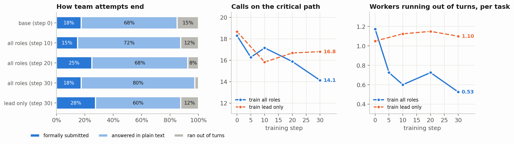

The left panel shows how team attempts end. At step 30 of `org_small`, only **18%** (`7/40`) of episodes end with the lead calling `submit(answer)`. Another **80%** (`32/40`) end with `status = "final_text"`, meaning the lead wrote a plain-text message with no tool call.

Why? In `agents.py`, if the lead replies without a tool call, `org_harness` immediately ends the episode and passes `m.content` to the grader:

```python
if not m.tool_calls:
    return done(m.content, "final_text", t + 1)
```

Because `tasks.grade` extracts the last number from a plain-text response, stating *"Therefore, the total is **156**"* in plain text earns the **exact same reward** as calling `submit(answer="156")`—and saves one tool-call token sequence. On two test tasks (`o19900003` in `org_small` and `o20200002` in `org_small_lead`), however, the lead writes an intermediate plain-text summary (*"Now I have the data from all sites, let me compile the monthly counts…"*), expecting to call `submit` on the next turn—and the harness cuts the episode off mid-thought. Giving the lead a one-turn nudge when it writes plain text before `LEAD_MAX_TURNS` is an easy fix for the next run.

### H.5 Training health and vLLM-to-trainer KL verification

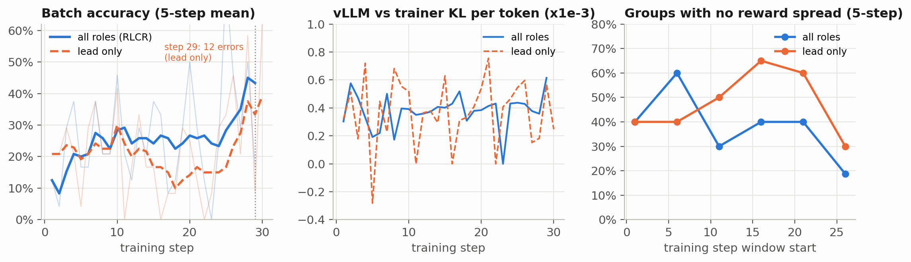

| Metric | `org_small` (all roles) | `org_small_lead` (lead only) |
|---|---|---|
| **Rollouts** | 30 steps × 24 = 720 org rollouts (~2,640 agent trajectories) | 30 steps × 24 = 720 org rollouts (~720 lead trajectories trained) |
| **Trainable rows / tokens per step (median)** | 52 rows (1 lead + $K$ workers per org) / 145k tokens | 15 rows (lead only) / 58k tokens |
| **Median step time** | 251 s rollout + 182 s training | 315 s rollout + 57 s training |
| **Peak trainer VRAM** | 10.6 GB (vLLM holds another 45% of the 24 GB card) | 10.6 GB |
| **vLLM vs trainer KL per token** | $3.9\times10^{-4}$ mean, max $6.0\times10^{-4}$ | $4.1\times10^{-4}$ mean, max $8.0\times10^{-4}$ |
| **Flat groups (0/6 or 6/6 correct)** | 38% (1.53 / 4 groups per step; drops to 0.75 / 4 in steps 26–29) | 48% (1.93 / 4 groups per step) |

The middle panel (`vLLM vs trainer KL per token`) verifies that the in-place merged-weight reload (`publish_merged`) works: the per-token KL between vLLM's sampled logprobs and the trainer's forward pass stays around $4\times10^{-4}$ across all 30 steps.

Notice two differences between the two training curves:

1. **Flat groups drop in `org_small`, but climb in `org_small_lead` mid-run.** In steps 11–25 of `org_small_lead`, more than half of all task groups (`2.0–2.6` out of `4`) had zero reward variance because all 6 organisations failed the task (`flat = 4/4` on steps 11, 16, and 22).
2. **Role drift on shared weights.** Because `lead` and `worker` share the same LoRA parameters, updating only on `lead` rows pushes the shared weights toward orchestrator patterns (`ask`/`submit`) without anchoring worker behavior. At step 29 of `org_small_lead`, 12 of the 24 rollouts threw errors and site coverage dipped to `0.50`. Training all roles together keeps the shared policy balanced across every role it has to play.

### H.6 LoRA parameterization and memory budget on one 24 GB GPU

In a single-agent run, one rollout is one conversation. In a multi-agent run, one rollout with $K=3$ sites is **four** separate multi-turn conversations (1 lead + 3 workers), totaling ~10,000–12,000 tokens per rollout, or ~250,000 tokens across a batch of 24 organisations. Meanwhile, the vLLM inference server is already sitting on 45% (~10.8 GB) of the RTX 3090 Ti's 24 GB of VRAM.

Full-parameter fine-tuning of a 2.6B model in bfloat16 (~5.4 GB of weights + ~5.4 GB of gradients + ~21.6 GB of fp32 AdamW master weights, momentum, and variance) would blow past 24 GB immediately. Instead, `train.py` uses **LoRA** (Low-Rank Adaptation): freeze all $2.697\text{B}$ base weights $W_0 \in \mathbb{R}^{d_{\text{out}} \times d_{\text{in}}}$ in bfloat16, and attach a trainable low-rank update to each linear projection:

$$
W \;=\; W_0 + \frac{\alpha}{r}\, B A, \qquad A \in \mathbb{R}^{r \times d_{\text{in}}},\; B \in \mathbb{R}^{d_{\text{out}} \times r}
$$

Here $r = 32$ and $\alpha = 32$ ($\alpha/r = 1$), with $A$ initialized from $\mathcal{N}(0, 0.02^2)$ and $B = 0$ so training begins from the exact base policy. Adapters are attached across all seven attention and SwiGLU MLP projections in every layer (`q_proj`, `k_proj`, `v_proj`, `out_proj`, `w1`, `w2`, `w3`). That comes to **40,271,872 trainable parameters**—just **1.47%** of the 2.74B total—so the frozen base model, LoRA gradients, AdamW state, and activation-checkpointed backward pass fit comfortably alongside vLLM in **~10.6 GB** of peak trainer VRAM.

### H.7 Held-out accuracy by step and test bucket

| Run | Step | `org` all ($n=40$) | `org` seen | `org` tmpl | `org` domain | `org` wide ($K=4$) | `solo` all ($n=40$) | `solo` seen | `solo` tmpl | `solo` domain | `solo` wide | Combined ($n=80$) |
|---|---|---|---|---|---|---|---|---|---|---|---|---|
| **All roles (`org_small`)** | 0 | 22.5% | 20% | 40% | 20% | 10% | 45.0% | 50% | 40% | 40% | 50% | 33.8% |
| **All roles (`org_small`)** | 5 | 25.0% | 30% | 20% | 50% | 0% | 40.0% | 50% | 60% | 20% | 30% | 32.5% |
| **All roles (`org_small`)** | 10 | 30.0% | 20% | 40% | 50% | 10% | 45.0% | 60% | 50% | 40% | 30% | 37.5% |
| **All roles (`org_small`)** | 20 | **37.5%** | 40% | **60%** | 40% | 10% | 42.5% | 20% | 40% | 50% | 60% | 40.0% |
| **All roles (`org_small`)** | **30** | **37.5%** | 30% | **60%** | **40%** | **20%** | **62.5%** | **70%** | **70%** | **70%** | 40% | **50.0%** |
| | | | | | | | | | | | | |
| **Lead only (`org_small_lead`)** | 0 | 30.0% | 30% | 50% | 20% | 20% | 42.5% | 30% | 30% | 40% | 70% | 36.2% |
| **Lead only (`org_small_lead`)** | 10 | 12.5% | 0% | 20% | 20% | 10% | 37.5% | 0% | 70% | 30% | 50% | 25.0% |
| **Lead only (`org_small_lead`)** | 20 | 27.5% | 20% | 30% | 50% | 10% | 42.5% | 60% | 50% | 20% | 40% | 35.0% |
| **Lead only (`org_small_lead`)** | **30** | **27.5%** | 40% | 40% | 30% | **0%** | **50.0%** | 50% | 30% | 70% | 50% | **38.8%** |

### H.8 Paired task-by-task comparisons (exact two-sided McNemar test)

| Comparison | Mode | Before / Run A | After / Run B | Fixed / Won | Broken / Lost | $p$ |
|---|---|---|---|---|---|---|
| **All roles (`org_small`): step 0 → 30** | `org` ($n=40$) | 22.5% (`9/40`) | **37.5% (`15/40`)** | 8 | 2 | 0.109 |
| **All roles (`org_small`): step 0 → 30** | `solo` ($n=40$) | 45.0% (`18/40`) | **62.5% (`25/40`)** | 13 | 6 | 0.167 |
| **All roles (`org_small`): step 0 → 30** | **both ($n=80$)** | **33.8% (`27/80`)** | **50.0% (`40/80`)** | **21** | **8** | **0.024** |
| **Lead only (`org_small_lead`): step 0 → 30** | `org` ($n=40$) | 30.0% (`12/40`) | 27.5% (`11/40`) | 4 | 5 | 1.000 |
| **Lead only (`org_small_lead`): step 0 → 30** | `solo` ($n=40$) | 42.5% (`17/40`) | 50.0% (`20/40`) | 12 | 9 | 0.664 |
| **Lead only (`org_small_lead`): step 0 → 30** | **both ($n=80$)** | 36.2% (`29/80`) | 38.8% (`31/80`) | 16 | 14 | 0.856 |
| **Step 30 head-to-head: `all` vs `lead`** | `org` ($n=40$) | 27.5% (`lead`) | **37.5% (`all`)** | 7 | 3 | 0.344 |
| **Step 30 head-to-head: `all` vs `lead`** | `solo` ($n=40$) | 50.0% (`lead`) | **62.5% (`all`)** | 10 | 5 | 0.302 |
| **Step 30 head-to-head: `all` vs `lead`** | **both ($n=80$)** | 38.8% (`lead`) | **50.0% (`all`)** | **17** | **8** | 0.108 |

### H.9 Coordination metrics (`org` eval, $n=40$)

| Coordination metric (`org` eval, $n=40$) | Base model (step 0) | Train lead only (step 30) | Train all roles (step 30) | Change in `all` (0 → 30) |
|---|---|---|---|---|
| **Critical-path latency (model calls)** | 18.3 | 16.8 | **14.1** | **−22.8%** |
| **Exhausted workers per task (hit 6-turn cap)** | 1.18 | 1.10 | **0.53** | **−55.3%** |
| **Worker model calls per task (sum across sites)** | 19.8 | 18.4 | **14.4** | **−27.3%** |
| **Worker sandbox tool calls per task** | 18.9 | 17.4 | **12.8** | **−32.5%** |
| **Worker plain-text reply fallbacks per task** | 3.20 | 2.88 | **2.35** | **−26.6%** |
| **Worker generated tokens per task** | 9,320 | 9,103 | **7,224** | **−22.5%** |
| **Lead generated tokens per task** | 2,829 | 2,121 | **2,374** | **−16.1%** |
| **Org episodes hitting `max_turns` (out of 40)** | 6 | 5 | **1** | **−83.3%** |
| **Solo episodes hitting `max_turns` (out of 40)** | 9 | 10 | **3** | **−66.7%** |
| **Eval wall-clock time (80 rollouts)** | 469 s | 434 s | **332 s** | **−29.2%** |

### H.10 Accuracy by slice

| Slice | $n$ | Base (step 0) | Lead only (step 30) | All roles (step 30) |
|---|---|---|---|---|
| **Org by site count**: $K=2$ / $K=3$ / $K=4$ (`wide`) | 12 / 18 / 10 | 17% / 33% / 10% | 42% / 33% / **0%** | **42% / 44% / 20%** |
| **Solo by site count**: $K=2$ / $K=3$ / $K=4$ (`wide`) | 12 / 18 / 10 | 25% / 56% / 50% | 50% / 50% / 50% | **75% / 67% / 40%** |
| **Difficulty (`org + solo`)**: easy / medium / hard | 20 / 32 / 28 | 50% / 34% / 21% | 45% / 44% / 29% | **70% / 59% / 25%** |
| **Problems in the data files (`org + solo`)**: none / one / two | 38 / 26 / 16 | 45% / 27% / 19% | 50% / 31% / 25% | **61% / 54% / 19%** |
| **Specific problems**: duplicate rows / inconsistent capitalisation / mixed date formats | 16 / 16 / 6 | 19% / 25% / 0% | 38% / 12% / 17% | **31% / 44% / 33%** |
