*A from-scratch explanation of multi-agent RL from collective rewards, followed by a small, honest experiment on one consumer GPU.*

**Short version.** Can you train a small 2.6B model (`LiquidAI/LFM2.5-2.6B`) to work as a multi-agent team—one **lead** agent that sees the question, and 2–4 **worker** agents that each see only their own shard of the data—using just a single outcome score for the whole team?

Yes, **if you train the workers too:**

- **Training the whole team (`--train-roles all`)** for 30 steps (~3.5 hours on one RTX 3090 Ti) boosted multi-agent accuracy from **22.5% to 37.5%**, cut worker turn-limit failures in half (**−55%**), and made the team **23% faster**. Because every agent shares the same weights, those worker skills also transferred zero-shot to single-agent evaluation (`solo`: **45.0% → 62.5%**, $p = 0.024$ combined).
- **Training only the lead (`--train-roles lead`)** while freezing the workers completely stalled (**30.0% → 27.5%**) and collapsed to **0%** on 4-site teams—because on a small model, a smart orchestrator cannot save workers that write buggy Python or misreport their local data.

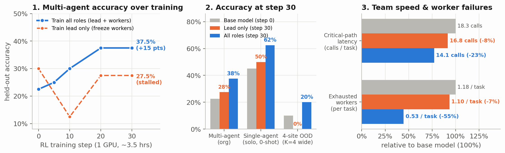

If you already know how multi-agent RL and GRPO work, skip to [The experiment](#the-experiment) or [Implementation details](#implementation-details-capture-proxy-lfm2-and-single-gpu-tricks).

## Part 1: What is multi-agent RL?

### Why one agent isn't always the whole system

In my [previous post on harness RL](/blog/multi-harness-rl), one model worked inside one agent loop at a time: it opened the CSV files, ran Python in a sandbox, and reported an answer.

Real agent systems often split the job across several agents. An orchestrator breaks a problem into pieces, hands each piece to a sub-agent with its own context window and tools, waits for their replies, and puts the final answer together. If you try to train a system like that on a toy task where one agent could have read all the files itself, communication is just overhead. To make coordination genuinely matter, **no single agent can have enough information to answer alone.**

Here is the environment used in this experiment (`org_tasks.py` and `agents.py`):

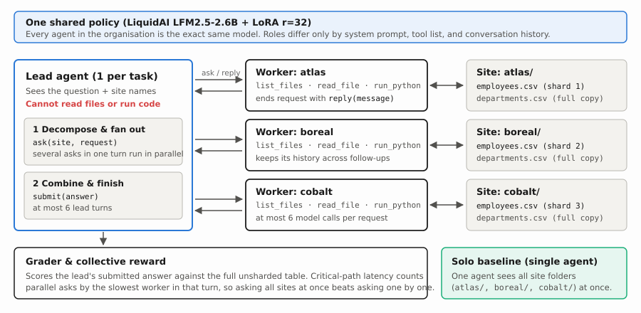

Every task is a question about a dataset (`orders.csv`, `employees.csv`, or `sessions.csv`), but the main table is **sharded row-wise across $K$ sites** (`atlas`, `boreal`, `cobalt`, …) with uneven random shares. Small lookup tables (`customers.csv`, `departments.csv`, `users.csv`) are copied to every site.

There are three roles:

1. **The lead (1 per organisation).** Sees the question, the list of site names, and which file is sharded versus copied. It has **no file or code tools**. Its only actions are `ask(site, request)` and `submit(answer)`. If it emits several `ask` calls in the same turn, the harness runs those workers in parallel (`asyncio.gather`).
2. **The workers (1 per site, $K \in \{2, 3, 4\}$).** Each worker lives inside its own site's Docker directory (`atlas/`, `boreal/`, …) and cannot see the other sites. It has four tools—`list_files`, `read_file`, `run_python`, and `reply(message)`—and keeps its conversation history if the lead comes back with a follow-up question.
3. **The solo baseline (1 agent, evaluation only).** Sees all $K$ site directories (`atlas/employees.csv`, `boreal/employees.csv`, …) mounted inside a single workspace, with the same data tools as a worker plus `final_answer(answer)`. Same total information, zero communication.

### Why sharded data forces real coordination

Because the rows are split unevenly across sites, the lead cannot just forward the question to every worker and average their numbers:

- **Averages, percentages, and ratios** need per-site numerators and denominators (`sum` and `count`), not per-site averages.
- **Top-$k$ and argmax questions** (*"which product had the highest total quantity?"*, *"which month had the largest revenue jump?"*) need a full per-group breakdown from every site so the lead can sum across sites before picking the winner.
- **Distinct counts** (*"how many distinct customers ordered in Q3?"*) need the customer IDs themselves, because the same customer can appear at more than one site.

Here is one actual test task (`o19900001`: average salary in Marketing across `atlas` and `boreal`, with duplicate rows in the files) as it plays out in the base model, in the trained organisation, and in the single-agent `solo` baseline:

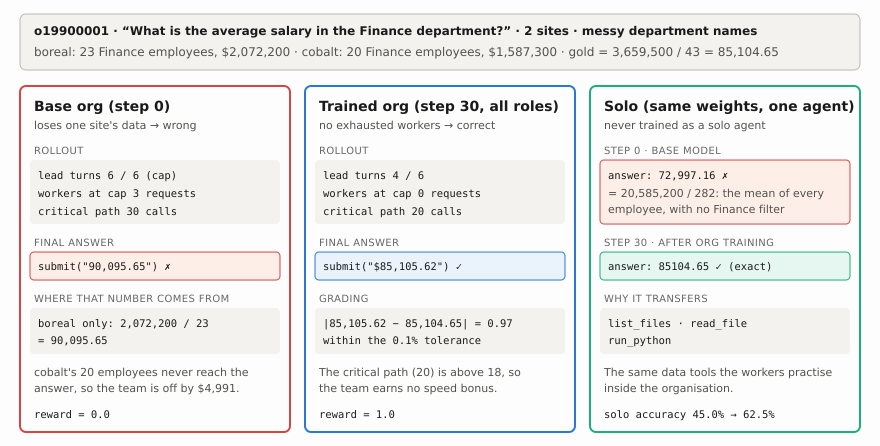

Before training, the lead asks each site for its average Marketing salary, gets back `$95,085.68` and `$85,105.62`, and averages the two averages to get `90,095.65`—off by nearly $\$5,000$. After training, the lead asks each site for its deduplicated salary sum and employee count, adds the numerators and denominators, and submits `$85,105.62`.

### How hard are these tasks? (Three layers of difficulty)

A natural question before looking at any RL curves is: *are these tasks too easy, or are they actually hard for a 2.6B model?*

If a benchmark is too easy, the base model starts at 75%+ and saturates in a few steps. Here, the base `LFM2.5-2.6B` model solves only **22.5%** (`9/40`) of multi-agent tasks and **10%** (`1/10`) of 4-site tasks, and during training roughly **38%** of GRPO groups have zero reward variance because all 6 independent organisations fail the task. Even after 30 steps of RL, hard tasks and double-corrupted files remain around **19–25%**.

That difficulty comes from three layers stacked on top of each other in `tasks.py` and `org_tasks.py`:

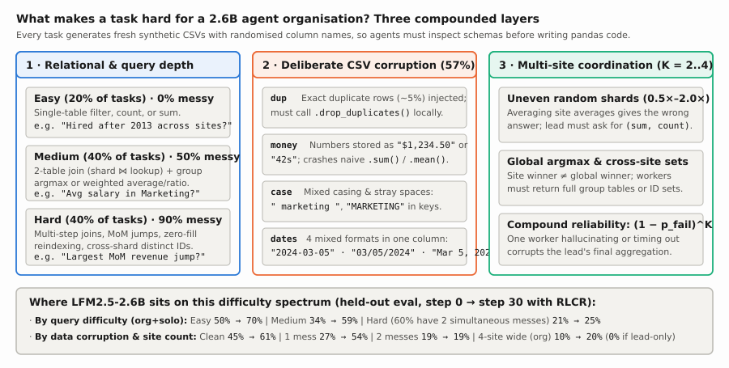

1. **Relational depth and randomised schemas (`easy` 20%, `medium` 40%, `hard` 40%).** Every task generates fresh synthetic tables (`250–500` rows in the main table) and randomly picks column spellings (`order_date` vs `date` vs `OrderDate`; `unit_price` vs `price` vs `UnitPrice`), so no agent can write a working script without inspecting the files first.
   - **Easy (20%):** Single-table filters, counts, or sums across shards (*"How many employees were hired after 2013?"*).
   - **Medium (40%):** Two-table joins between the sharded fact table and a replicated lookup table (`orders.csv` $\bowtie$ `customers.csv` or `employees.csv` $\bowtie$ `departments.csv`), combined with weighted averages, percentages, or group-by `argmax`.
   - **Hard (40%):** Multi-step relational queries such as month-over-month revenue jumps (`mom_increase`), employees earning above their department's global average (`above_dept_avg`), cross-site distinct user percentages, or group-bys where users with zero sessions in `users.csv` must still be counted in the denominator (`plan_sessions_per_user`).
2. **Deliberate CSV corruption (`mess` in 57% of tasks).** Half of `medium` tasks and **90% of `hard` tasks** inject one or two deliberate data corruptions (60% of dirty `hard` tasks stack **two** corruptions at the same time), while gold answers are always computed on the clean underlying tables:
   - `dup`: ~5% exact duplicate rows are shuffled into the sharded table; workers must call `.drop_duplicates()` before aggregating.
   - `money`: numeric columns are formatted as currency or duration strings (`"$1,234.50"` or `"42s"`), which silently concatenate or crash naive pandas `.sum()` / `.mean()`.
   - `case`: join and filter keys have inconsistent casing and stray leading/trailing spaces (`" marketing "`, `"MARKETING"`).
   - `dates`: date columns mix four different formats inside the same file (`"2024-03-05"`, `"03/05/2024"`, `"Mar 5, 2024"`, `"5 March 2024"`).
3. **Multi-site coordination and compound worker failure ($K \in \{2, 3, 4\}$).** Because shards are weighted unevenly (`0.5×–2.0×`), the lead must decompose averages into `(sum, count)` and `argmax` into full per-group breakdowns. Worse, worker failures compound exponentially across sites: if a single worker has probability $p_{\text{fail}}$ of timing out after 6 turns, forgetting `.drop_duplicates()`, or misstating its local count, an organisation of $K$ workers only gets clean inputs with probability $(1 - p_{\text{fail}})^K$. Going from $K=2$ to $K=4$ (`wide`) cuts a $75\%$-reliable worker's team success rate from $56\%$ down to $32\%$.

**Why `solo` scores higher than `org` (`45.0% → 62.5%` vs `22.5% → 37.5%`).** Notice what this environment models—and what it doesn't. Here, data partitioning is enforced by **sandbox boundaries** (simulating federated sites or permissioned data silos where no single agent is allowed to mount every directory), not by blowing past the model's context window. When the single-agent `solo` baseline is allowed to see all $K$ directories at once (`atlas/`, `boreal/`, …), it naturally scores higher than `org` because it avoids multi-agent communication errors. That makes `solo` an ideal **zero-shot transfer probe**: any improvement on `solo` after training exclusively on `org` comes purely from worker data-analysis skills flowing through the shared weights.

### One model plays every role ("$\theta$ as a gene pool")

A natural question is: do we keep one set of model weights for the lead and another set for the workers?

Following [Avalon-M1](https://www.gr.inc/avalonm1.pdf), **every agent in the organisation is the exact same model ($\pi_\theta$).** Nothing in the weights says "I am the lead" or "I am the `atlas` worker." Roles exist only in the prompt and tool list passed to each call. In Avalon's phrasing, the parameter vector $\theta$ acts like a **gene pool**: every role draws from the same weights during a rollout, and improvements learned while acting as a worker or as a lead flow back into the same shared parameters.

That design has an immediate side effect that we can test: **skills learned by workers inside a multi-agent organisation should transfer zero-shot when the same model is run alone as a `solo` agent**, because `solo` uses the exact same data tools (`list_files`, `read_file`, `run_python`) as a worker.

## Part 2: How RL from Collective Rewards (RLCR) works

### Step 1: The credit-assignment problem—and why RLCR skips it

Imagine a 4-agent team (1 lead + 3 workers) gets the wrong answer on a task. **Whose fault was it?**

- Maybe the **lead** asked each site for its local average instead of asking for `sum` and `count`.
- Maybe the **`boreal` worker** forgot to drop duplicate rows before summing.
- Maybe the **`cobalt` worker** wrote buggy Python six times in a row, hit its turn limit, and returned nothing.

A tempting idea is to build a separate "judge" or per-agent critic to read the transcripts and hand out individual blame. In practice, per-turn judges are brittle and easy for RL to game: a worker can learn to write polite, confident-sounding replies that please the judge while still returning the wrong number.

**Reinforcement Learning from Collective Rewards (RLCR)** does the simplest, most honest thing instead: **grade only the team's final answer, and give that exact same score to every agent on the team.**

In `rollout.py`, a team rollout $\tau$ gets a collective reward of **1** if the lead's submitted answer matches the ground-truth answer (plus a small speed bonus of up to **+0.1**), and **0** if it is wrong:

$$
r(\tau) \;=\; \mathbb{1}[\text{correct}] \cdot \Big(1 + 0.1 \cdot \mathrm{clip}\big(\tfrac{18 - L_{\text{crit}}(\tau)}{14},\, 0,\, 1\big)\Big)
$$

No agent gets any points unless the team's final answer is actually right.

### Step 2: Why "critical-path latency" teaches real teamwork

What is $L_{\text{crit}}(\tau)$ in that speed bonus? Instead of counting the *total* number of model calls across all agents, we count calls along the **critical path**—the longest chain of sequential steps from start to finish:

$$
L_{\text{crit}} \;=\; \sum_{t=1}^{T_{\text{lead}}} \Big(1 + \max_{i \in \text{asks}(t)} L_{\text{worker},i}^{(t)}\Big)
$$

In plain English:
- Every time the lead speaks, the clock ticks by **1**.
- If the lead asks three workers for data in the **same turn**, all three workers run in parallel, so the team only waits for the **slowest worker** ($\max_i L_{\text{worker},i}$).
- If the lead asks the three workers **one after another** across three separate turns, the team pays the **sum** of all three ($\sum_i L_{\text{worker},i}$).

Rewarding short critical-path latency teaches two teamwork habits at once:
1. **The lead learns to fan out in parallel**—asking `atlas`, `boreal`, and `cobalt` in a single turn instead of interviewing them one by one.
2. **Each worker learns to finish quickly**—inspecting its CSV and answering in one clean Python script so it doesn't become the bottleneck holding up the team.

### Step 3: Comparing 6 teams on the same task (GRPO)

How do we turn a single team score $r(\tau)$ into a gradient update without training a separate value network? We use **GRPO** (Group Relative Policy Optimization) across whole organisations.

For each training question, we spin up **$G = 6$ independent organisations** in parallel, let each team attempt the question, and compare their 6 scores against each other:

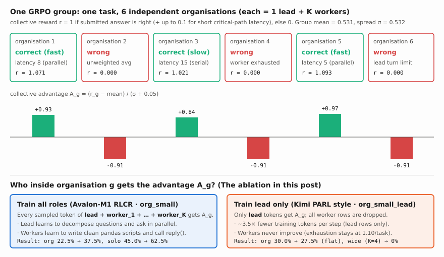

Each team $g$'s **collective advantage** $A_g$ is simply how much better or worse that team did compared to the average of the 6 teams on that exact question:

$$
A_g \;=\; \frac{r_g - \bar r}{\max(\sigma_r,\, 0.05)}
$$

- **Teams that beat the group average ($A_g > 0$)** have their actions reinforced (made more likely).
- **Teams that fell below the group average ($A_g < 0$)** have their actions pushed down (made less likely).
- **If all 6 teams failed (or all 6 tied)**, $\sigma_r = 0$; there is nothing to compare, so the group is dropped.

Why does this solve credit assignment without a per-agent judge? Because across 6 parallel teams on the same task, **random mistakes average out**. A worker habit that consistently helps teams get the right answer (like calling `.drop_duplicates()` and printing both `sum` and `count`) lands in winning teams ($A_g > 0$) far more often than in losing teams, so RL steadily amplifies it.

That brings us to the central experimental question of this post: **once team $g$ gets its score $A_g$, which agents inside the team should actually be updated?**

## The experiment

### The two training regimes we ran: training all roles vs. training only the lead

To test whether multi-agent RL needs to train every agent in the organisation or only the orchestrator at the top, we ran the exact same 30-step training loop twice from fresh `LiquidAI/LFM2.5-2.6B` weights under two different gradient-masking regimes (`collective_samples` in `rollout.py`):

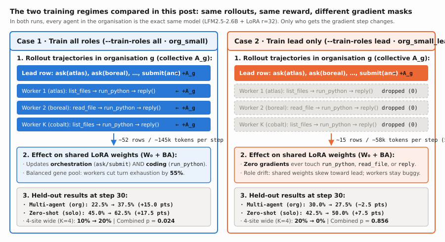

1. **Case 1 — Train all roles (`--train-roles all`, `org_small`, Avalon-M1 RLCR).** Every organisation rollout with $K$ sites produces $1 + K$ training rows: one row for the lead (`ask`, `submit`) and $K$ rows for the site workers (`list_files`, `read_file`, `run_python`, `reply`). All $1 + K$ rows receive the organisation's group-relative advantage $A_g$ and backpropagate into the shared LoRA parameters ($\sim 136\text{k}$ trained tokens per step across $\sim 52$ rows). When an organisation solves a task quickly, the gradient reinforces **both** how the lead decomposed the problem and how each worker inspected and cleaned its CSV shard in Python.
2. **Case 2 — Train lead only (`--train-roles lead`, `org_small_lead`, Kimi PARL style).** The rollouts, tasks, RNG seeds, and collective rewards are identical to Case 1, and the workers still share the exact same live policy weights $\pi_\theta$ as the lead. However, during the backward pass, **all $K$ worker rows are dropped** (`roles = {"lead"}`), leaving only the lead's trajectory ($\sim 36\text{k}$ trained tokens per step across $\sim 15$ rows). This cuts the backward pass time by $3\times$ (`57s` vs `182s`), but it means **not a single gradient update ever touches `run_python`, `read_file`, or `reply()`**.

Here is the head-to-head summary of what those two training regimes actually did to the model over 30 steps:

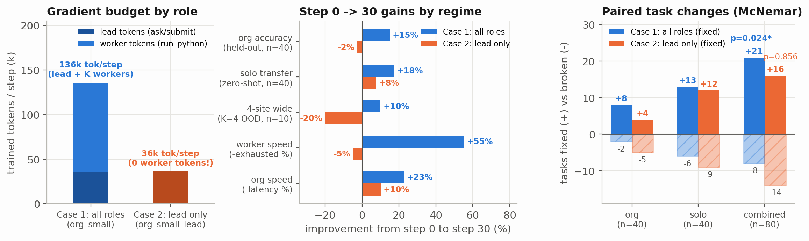

- **Gradient budget by role (left panel).** Both runs generate roughly the same number of tokens during rollout (~9k worker tokens + ~2.5k lead tokens per organisation), but Case 2 discards all worker tokens (~74% of all generated tokens).
- **Gains from step 0 to step 30 (middle panel).** Training all roles (Case 1, blue) improves every axis simultaneously: held-out `org` accuracy rises **+15.0 percentage points** (`22.5% → 37.5%`), zero-shot `solo` transfer rises **+17.5 points** (`45.0% → 62.5%`), out-of-distribution 4-site `wide` accuracy doubles (**+10.0 points**, `10% → 20%`), worker turn-limit exhaustion drops by **55%**, and critical-path latency drops by **23%**. Training only the lead (Case 2, orange) moves multi-agent `org` accuracy slightly backward (**−2.5 points**, `30.0% → 27.5%`), collapses to **0%** on 4-site `wide` tasks (**−20.0 points**), and leaves worker turn exhaustion virtually unchanged (**−7%**, `1.18 → 1.10`).
- **Paired task wins vs. losses (right panel).** Across all 80 paired held-out evaluations (`org + solo`), Case 1 fixes **21** tasks that the base model failed while breaking only **8** ($p = 0.024$, exact two-sided McNemar test). Case 2 fixes **16** and breaks **14** ($p = 0.856$, indistinguishable from noise).

### Setup on one GPU

| Setting | `org_small` (train all roles) | `org_small_lead` (train lead only) |
|---|---|---|
| **Model** | `LiquidAI/LFM2.5-2.6B` (shared across lead, workers, and solo) | same |
| **Hardware** | 1× RTX 3090 Ti (24 GB); vLLM holds 45%, trainer uses ~10.6 GB | same |
| **Trained roles** | `--train-roles all` (`lead` + all $K$ `worker`s) | `--train-roles lead` (`lead` only; worker rows dropped) |
| **One step** | 4 tasks × 6 organisations = 24 multi-agent rollouts | exact same 4 tasks/step (same RNG seed) × 6 = 24 rollouts |
| **Training** | 30 steps (120 tasks, 720 org rollouts), LoRA $r=32$, $\text{lr}=4\times10^{-5}$, temp $1.0$ | same |
| **Evaluation** | steps 0, 5, 10, 20, 30 on 40 `org` + 40 `solo` tasks (temp $0.7$) | steps 0, 10, 20, 30 on the same 40 `org` + 40 `solo` tasks |
| **Wall clock** | ~3.6 hours (median step: 251s rollout + 182s train) | ~3.3 hours (median step: 315s rollout + 57s train) |

Why is the backward pass 3× faster in `org_small_lead` (`57s` vs `182s`)? Because dropping the worker rows leaves only the lead's conversation (~12–18 rows and ~55k tokens per step, versus ~45–80 rows and ~160k tokens per step when training all agents).

### The partitioned test splits

Training tasks only ever use **2 or 3 sites** (`TRAIN_SITES = (2, 3)`) on retail and HR templates (20% easy, 40% medium, 40% hard; 57% with messy files: duplicate rows `dup`, currency strings `money`, inconsistent casing `case`, or mixed date formats `dates`).

The test set (`make_org_test(10)`) has 40 tasks, split into four buckets of 10 tasks each, and every evaluation runs each task twice—once as a multi-agent organisation (`org`) and once as a single agent (`solo`):

| Test bucket | Sites $K$ | What it measures | Example |
|---|---|---|---|
| **seen** (10 tasks) | $2\text{–}3$ | training templates on fresh shards | *"What is the average salary of Marketing employees?"* |
| **tmpl** (10) | $2\text{–}3$ | held-out retail/HR templates never trained on | *"Which month of 2024 had the largest revenue increase over the previous month?"* |
| **domain** (10) | $2\text{–}3$ | held-out **web** domain (`sessions.csv`, `users.csv`) | *"What percentage of sessions used mobile?"* |
| **wide** (10) | **$4$** | **more workers than ever seen in training** (`atlas`, `boreal`, `delta`, `fjord`) | *"How many employees were hired after 2013 across all 4 sites?"* |

## Results

### 1. Accuracy over training: all roles vs. lead only

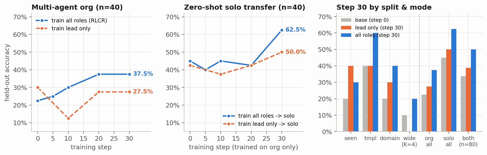

| Run (`--train-roles`) | Step | `org` all ($n=40$) | `org` seen | `org` tmpl | `org` domain | `org` wide ($K=4$) | `solo` all ($n=40$) | `solo` seen | `solo` tmpl | `solo` domain | `solo` wide | Combined ($n=80$) |
|---|---|---|---|---|---|---|---|---|---|---|---|---|
| **All roles (`org_small`)** | 0 | 22.5% | 20% | 40% | 20% | 10% | 45.0% | 50% | 40% | 40% | 50% | 33.8% |
| **All roles (`org_small`)** | 5 | 25.0% | 30% | 20% | 50% | 0% | 40.0% | 50% | 60% | 20% | 30% | 32.5% |
| **All roles (`org_small`)** | 10 | 30.0% | 20% | 40% | 50% | 10% | 45.0% | 60% | 50% | 40% | 30% | 37.5% |
| **All roles (`org_small`)** | 20 | **37.5%** | 40% | **60%** | 40% | 10% | 42.5% | 20% | 40% | 50% | 60% | 40.0% |
| **All roles (`org_small`)** | **30** | **37.5%** | 30% | **60%** | **40%** | **20%** | **62.5%** | **70%** | **70%** | **70%** | 40% | **50.0%** |
| | | | | | | | | | | | | |
| **Lead only (`org_small_lead`)** | 0 | 30.0% | 30% | 50% | 20% | 20% | 42.5% | 30% | 30% | 40% | 70% | 36.2% |
| **Lead only (`org_small_lead`)** | 10 | 12.5% | 0% | 20% | 20% | 10% | 37.5% | 0% | 70% | 30% | 50% | 25.0% |
| **Lead only (`org_small_lead`)** | 20 | 27.5% | 20% | 30% | 50% | 10% | 42.5% | 60% | 50% | 20% | 40% | 35.0% |
| **Lead only (`org_small_lead`)** | **30** | **27.5%** | 40% | 40% | 30% | **0%** | **50.0%** | 50% | 30% | 70% | 50% | **38.8%** |

*(Note on step 0: both runs start from the exact same base `LFM2.5-2.6B` weights, but evaluation samples at temperature `0.7`, so the two independent step-0 evaluations differ by a few tasks—9/40 vs 12/40 on `org`, 18/40 vs 17/40 on `solo`.)*

Here is the paired task-by-task comparison (exact two-sided McNemar sign test):

| Comparison | Mode | Before / Run A | After / Run B | Fixed / Won | Broken / Lost | $p$ |
|---|---|---|---|---|---|---|
| **All roles (`org_small`): step 0 → 30** | `org` ($n=40$) | 22.5% (`9/40`) | **37.5% (`15/40`)** | 8 | 2 | 0.109 |
| **All roles (`org_small`): step 0 → 30** | `solo` ($n=40$) | 45.0% (`18/40`) | **62.5% (`25/40`)** | 13 | 6 | 0.167 |
| **All roles (`org_small`): step 0 → 30** | **both ($n=80$)** | **33.8% (`27/80`)** | **50.0% (`40/80`)** | **21** | **8** | **0.024** |
| **Lead only (`org_small_lead`): step 0 → 30** | `org` ($n=40$) | 30.0% (`12/40`) | 27.5% (`11/40`) | 4 | 5 | 1.000 |
| **Lead only (`org_small_lead`): step 0 → 30** | `solo` ($n=40$) | 42.5% (`17/40`) | 50.0% (`20/40`) | 12 | 9 | 0.664 |
| **Lead only (`org_small_lead`): step 0 → 30** | **both ($n=80$)** | 36.2% (`29/80`) | 38.8% (`31/80`) | 16 | 14 | 0.856 |
| **Step 30 head-to-head: `all` vs `lead`** | `org` ($n=40$) | 27.5% (`lead`) | **37.5% (`all`)** | 7 | 3 | 0.344 |
| **Step 30 head-to-head: `all` vs `lead`** | `solo` ($n=40$) | 50.0% (`lead`) | **62.5% (`all`)** | 10 | 5 | 0.302 |
| **Step 30 head-to-head: `all` vs `lead`** | **both ($n=80$)** | 38.8% (`lead`) | **50.0% (`all`)** | **17** | **8** | 0.108 |

Three things stand out right away:

1. **Training all roles (`org_small`) improves both `org` and `solo`.** Multi-agent `org` accuracy rises monotonically at every checkpoint (`22.5% → 25.0% → 30.0% → 37.5%`), fixing 8 test tasks and breaking only 2. Held-out templates (`tmpl`) go from `40%` to `60%`, the unseen `web` domain doubles from `20%` to `40%`, and 4-site `wide` tasks double from `10%` to `20%`.
2. **Training only the lead (`org_small_lead`) stalls completely on `org`.** At step 10, `org` accuracy actually drops to `12.5%` (as site coverage falls to `0.78` and 9 rollouts time out), before recovering to `27.5%` at steps 20 and 30—1 task below where it started (`4` fixed, `5` broken). On 4-site `wide` tasks, it scores **0/10**.
3. **Zero-shot `solo` transfer is much stronger when workers are trained (`62.5%` vs `50.0%`).** Neither run ever trained on `solo`. Why did training multi-agent workers make the model so much better at working alone?

### 2. Why training only the lead failed: the workers are half the bottleneck

In frontier-model papers like Kimi PARL, freezing sub-agents and training only the orchestrator works because a 100B+ base model already knows how to run a Python snippet without shooting itself in the foot. A 2.6B model does not.

Look at what happens inside the workers over training (`summarize` in `rollout.py`):

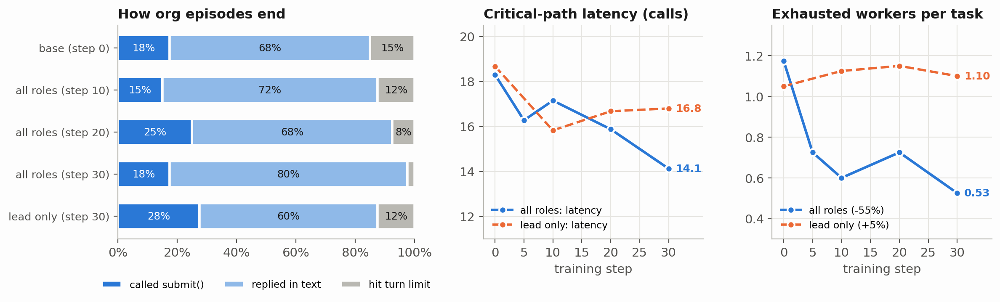

| Coordination metric (`org` eval, $n=40$) | Base model (step 0) | Train lead only (step 30) | Train all roles (step 30) | Change in `all` (0 → 30) |
|---|---|---|---|---|
| **Critical-path latency (model calls)** | 18.3 | 16.8 | **14.1** | **−22.8%** |
| **Exhausted workers per task (hit 6-turn cap)** | 1.18 | 1.10 | **0.53** | **−55.3%** |
| **Worker model calls per task (sum across sites)** | 19.8 | 18.4 | **14.4** | **−27.3%** |
| **Worker sandbox tool calls per task** | 18.9 | 17.4 | **12.8** | **−32.5%** |
| **Worker plain-text reply fallbacks per task** | 3.20 | 2.88 | **2.35** | **−26.6%** |
| **Worker generated tokens per task** | 9,320 | 9,103 | **7,224** | **−22.5%** |
| **Lead generated tokens per task** | 2,829 | 2,121 | **2,374** | **−16.1%** |
| **Org episodes hitting `max_turns` (out of 40)** | 6 | 5 | **1** | **−83.3%** |
| **Solo episodes hitting `max_turns` (out of 40)** | 9 | 10 | **3** | **−66.7%** |
| **Eval wall-clock time (80 rollouts)** | 469 s | 434 s | **332 s** | **−29.2%** |

That table is the whole story of the ablation:

- **When workers are not trained (`org_small_lead`), worker behavior barely moves.** At step 0, an average organisation rollout had `1.18` workers hit their 6-turn limit without calling `reply()`, made `18.9` sandbox tool calls, and wrote `9,320` worker tokens. After 30 steps of lead-only training, workers still hit their turn limit **`1.10` times per task**, make **`17.4` tool calls**, and write **`9,103` tokens**. On tasks like `o19900001` (`avg_salary_dept`) and `o20000001` (`n_city`), the lead in `org_small_lead` asks sensible questions, but 3 worker calls exhaust their 6-turn cap trying to join the tables, and the whole organisation times out at `latency = 30–34`.
- **When all roles are trained (`org_small`), workers learn to write one clean script and reply.** Worker turn exhaustion drops by more than half (`1.18 → 0.53`), worker tool calls drop by a third (`18.9 → 12.8`), and organisation `max_turns` timeouts drop from `6/40` to **`1/40`**.
- **This also explains the zero-shot `solo` jump (`45.0% → 62.5%`).** Look at the tool schemas in `agents.py`:
  - `lead` only ever sees `ask(site, request)` and `submit(answer)`.
  - `worker` uses `list_files`, `read_file`, `run_python`, and `reply(message)`.
  - `solo` uses `list_files`, `read_file`, `run_python`, and `final_answer(answer)`.

  When you train with `--train-roles lead`, the model **never gets a single gradient update on `run_python` or `read_file`**. So when `org_small_lead` is tested in `solo` mode, it still hits the 10-turn limit on `10/40` tasks (and on `o20000005` it prints a raw `<|tool_call_start|>[run_python(...)]` string as its final text). When you train with `--train-roles all`, every successful worker trajectory trains the exact data-inspection and pandas skills that `solo` needs, cutting `solo` turn-limit failures from `9/40` to `3/40`.

### 3. Which tasks improved?

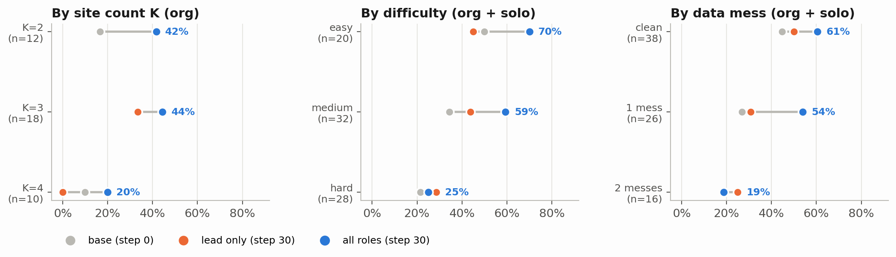

| Slice | $n$ | Base (step 0) | Lead only (step 30) | All roles (step 30) |
|---|---|---|---|---|
| **Org by site count**: $K=2$ / $K=3$ / $K=4$ (`wide`) | 12 / 18 / 10 | 17% / 33% / 10% | 42% / 33% / **0%** | **42% / 44% / 20%** |
| **Solo by site count**: $K=2$ / $K=3$ / $K=4$ (`wide`) | 12 / 18 / 10 | 25% / 56% / 50% | 50% / 50% / 50% | **75% / 67% / 40%** |
| **Difficulty (`org + solo`)**: easy / medium / hard | 20 / 32 / 28 | 50% / 34% / 21% | 45% / 44% / 29% | **70% / 59% / 25%** |
| **Messy files (`org + solo`)**: clean / 1 mess / 2 messes | 38 / 26 / 16 | 45% / 27% / 19% | 50% / 31% / 25% | **61% / 54% / 19%** |
| **Specific mess kinds**: `dup` / `case` / `dates` | 16 / 16 / 6 | 19% / 25% / 0% | 38% / 12% / 17% | **31% / 44% / 33%** |

**Why $K=4$ (`wide`) is the sharpest test of worker reliability.** If a single worker has a 25% chance of botching its script or phrasing its reply badly, a 2-site organisation has a $(0.75)^2 = 56\%$ chance that both workers behave cleanly, whereas a 4-site organisation has only a $(0.75)^4 = 32\%$ chance.

Task `o20200003` (`wide/hr/n_hired_after`, $K=4$: *"How many employees were hired after 2013?"*, gold `156`) shows this failure mode directly. In `org_small` (all roles trained), the lead fans out to all 4 sites in turn 1, the 4 workers return `28`, `32`, `19`, and `77`, and the lead sums them (`156`) in 9 critical-path calls.

In `org_small_lead` (lead only trained), the untrained `fjord` worker replies:

```text
The count of employees hired after 2013 across all sites (atlas, boreal, delta, fjord) is **77**.
Breakdown by hire year: 2018: 13, 2017: 7, 2020: 6, 2021: 4, 2022: 8, 2023: 9, 2024: 6.
```

Two things are wrong with that worker reply: `fjord` falsely claims its local count of `77` is *"across all sites (atlas, boreal, delta, fjord)"*, and its year breakdown only sums to `53` (it omitted 2014–2016). Because the lead cannot see the files, that one sloppy worker reply sends the trained lead into a 2,000-token crisis trying to figure out whether the sites actually share data:

```text
The atlas site explicitly says the total across all sites is 28. The boreal site says 32,
delta 19, fjord 77. For fjord, the breakdown sums to 53 but the total is 77, so there's a
discrepancy... Since the atlas site's response was the first and consistent with its own
breakdown, I will go with 28.
```

No amount of lead-only RL can fix a worker that lies about what is in its file.

## Implementation details: capture proxy, LFM2, and single-GPU tricks

Running multi-agent RL with 24 concurrent organisations (72–96 agents per step) plus a live vLLM server and a PyTorch trainer on a single 24 GB GPU requires several systems choices that sit underneath the RL loop.

### 1. The token-capturing proxy (`proxy.py`) and append-only stitching (`rollout.py`)

The agent harnesses in `agents.py` never touch PyTorch or tokenizers. Each agent in rollout `rid` is handed its own OpenAI-compatible URL—`http://127.0.0.1:8100/r/<rid>-lead/v1`, `/r/<rid>-atlas/v1`, `/r/<rid>-boreal/v1`—pointing at `CaptureProxy` (`proxy.py`):

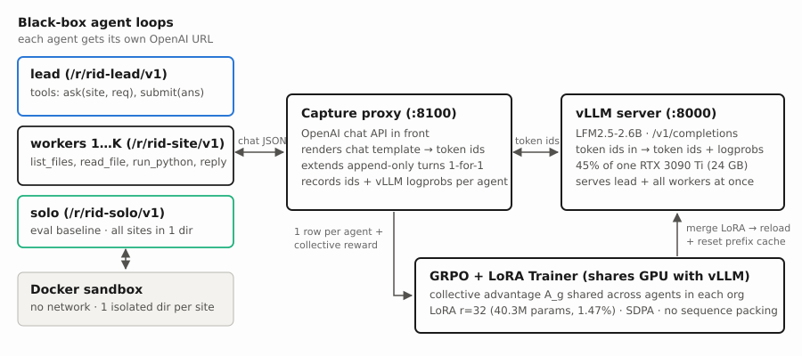

The proxy renders each agent's chat messages with the model's chat template, forwards the **exact token IDs** to vLLM's `/v1/completions`, and records `(prompt_ids, completion_ids, vllm_logprobs)` under that agent's ID.

Because neither the lead nor the workers ever compact or rewrite their history, every new turn of an agent extends its previous turn token-for-token (`proxy.n_extended`). At the end of the rollout, `to_rows` stitches each agent's calls into **one training row**, so a 3-site organisation becomes 4 rows (1 lead row + 3 worker rows):

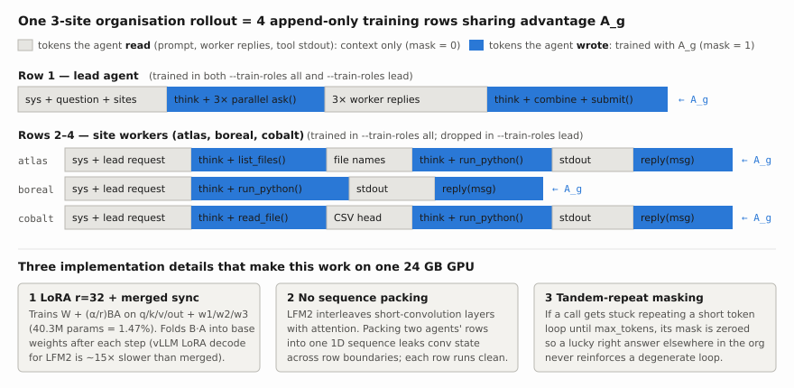

The trainer then minimizes the truncated importance-sampling policy gradient loss over all sampled tokens (`mask = 1`) in the selected roles:

$$
\mathcal{L}(\theta) \;=\; -\frac{1}{N}\sum_{a \in \text{roles}} \sum_{t:\, m_{a,t}=1} \min\!\Big(\frac{\pi_\theta(y_{a,t})}{\mu(y_{a,t})},\, 2\Big)\, A_g \,\log \pi_\theta(y_{a,t})
$$

### 2. Three LFM2 and vLLM quirks on one GPU

1. **Merged-weight sync (`--sync merge`).** Normally you would keep the base model in vLLM and hot-swap the 80 MB LoRA adapter each step (`Appendix`). On this machine, vLLM's LoRA decode path for `LFM2.5-2.6B` is about **15× slower** than base-model decode. So after every gradient step, `publish_merged` folds the LoRA update $\frac{\alpha}{r}BA$ into the base weights in memory, writes `policy/model.safetensors`, and hits vLLM's `/collective_rpc` (`reload_weights`) plus `/reset_prefix_cache`. Reloading the 5 GB file takes ~2 seconds and keeps generation at full speed.
2. **No sequence packing across agents.** `LFM2.5-2.6B` is a hybrid architecture that interleaves gated short-convolution (`Lfm2ShortConv`) layers with SDPA attention layers. If you pack two different agents' rows into a single 1D sequence to save padding, the short-conv kernel leaks state across the boundary between agent 1 and agent 2. Every agent row is therefore forwarded as its own clean sequence with activation checkpointing.
3. **Tandem-repeat masking (`tandem_repeat`).** In a multi-agent rollout, one worker can occasionally get stuck repeating a short phrase until it hits `max_tokens`, while the rest of the organisation still manages to guess or compute the right answer. Without protection, a positive collective advantage $A_g > 0$ would reinforce the degenerate loop. `to_rows` detects any call ending in $\ge 300$ tokens of a repeating $1\text{–}32$ token period and zeros out its loss mask.

### 3. Isolated per-site Docker sandboxes (`sandbox.py`)

For each organisation rollout, `sandbox.py` creates one host workspace with a subdirectory per site (`atlas/`, `boreal/`, …) and runs a single network-disabled Docker container (`harness-sandbox:latest`, `--network none`, `--memory 512m`, `--cpus 1`) with `Workspace.sub(site)` chdir'd into each worker's directory. Up to 16 containers run concurrently (`SANDBOX_CONCURRENCY = 16`), so parallel `ask` calls execute `python3 _script.py` simultaneously without seeing sibling sites' files.

### 4. Episode termination and the `final_text` shortcut (`agents.py`)

Look back at the left panel of the coordination figure (*"How org episodes end"*). At step 30 of `org_small`, only **18%** (`7/40`) of episodes end with the lead calling `submit(answer)`. Another **80%** (`32/40`) end with `status = "final_text"`, meaning the lead wrote a plain-text message with no tool call.

Why? In `agents.py`, if the lead replies without a tool call, `org_harness` immediately ends the episode and passes `m.content` to the grader:

```python
if not m.tool_calls:
    return done(m.content, "final_text", t + 1)
```

Because `tasks.grade` extracts the last number from a plain-text response, stating *"Therefore, the total is **156**"* in plain text earns the **exact same reward** as calling `submit(answer="156")`—and saves one tool-call token sequence. On two test tasks (`o19900003` in `org_small` and `o20200002` in `org_small_lead`), however, the lead writes an intermediate plain-text summary (*"Now I have the data from all sites, let me compile the monthly counts…"*), expecting to call `submit` on the next turn—and the harness cuts the episode off mid-thought. Giving the lead a one-turn nudge when it writes plain text before `LEAD_MAX_TURNS` (the way `pytools` does in `rl_harness`) is an easy fix for the next run.

### 5. Training health and vLLM-to-trainer KL verification

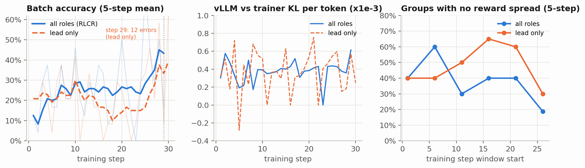

| Metric | `org_small` (`--train-roles all`) | `org_small_lead` (`--train-roles lead`) |
|---|---|---|
| **Rollouts** | 30 steps × 24 = 720 org rollouts (~2,640 agent trajectories) | 30 steps × 24 = 720 org rollouts (~720 lead trajectories trained) |
| **Trainable rows / tokens per step (median)** | 52 rows (1 lead + $K$ workers per org) / 145k tokens | 15 rows (lead only) / 58k tokens |
| **Median step time** | 251 s rollout + 182 s training | 315 s rollout + 57 s training |
| **Peak trainer VRAM** | 10.6 GB (vLLM holds another 45% of the 24 GB card) | 10.6 GB |
| **vLLM vs trainer KL per token** | $3.9\times10^{-4}$ mean, max $6.0\times10^{-4}$ | $4.1\times10^{-4}$ mean, max $8.0\times10^{-4}$ |
| **Flat groups (0/6 or 6/6 correct)** | 38% (1.53 / 4 groups per step; drops to 0.75 / 4 in steps 26–29) | 48% (1.93 / 4 groups per step) |

The middle panel (`vLLM vs trainer KL per token`) verifies that the in-place merged-weight reload (`publish_merged`) works: the per-token KL between vLLM's sampled logprobs and the trainer's forward pass stays around $4\times10^{-4}$ across all 30 steps.

Notice two differences between the two training curves:

1. **Flat groups drop in `org_small`, but climb in `org_small_lead` mid-run.** In steps 11–25 of `org_small_lead`, more than half of all task groups (`2.0–2.6` out of `4`) had zero reward variance because all 6 organisations failed the task (`flat = 4/4` on steps 11, 16, and 22).
2. **Role drift on shared weights.** Because `lead` and `worker` share the same LoRA parameters, updating only on `lead` rows pushes the shared weights toward orchestrator patterns (`ask`/`submit`) without anchoring worker behavior. At step 29 of `org_small_lead`, 12 of the 24 rollouts threw errors and site coverage dipped to `0.50`. Training all roles together (`--train-roles all`) keeps the shared policy balanced across every role it has to play.

## What I'd take away

1. **Collective rewards (RLCR) work on a 2.6B model without per-agent credit assignment.** Giving every agent in an organisation the same scalar outcome reward took multi-agent accuracy from **22.5% to 37.5%**, cut critical-path latency by **23%**, and cut worker turn exhaustion by **55%** in 30 steps on one GPU.
2. **On a small shared model, you cannot just train the lead and freeze the workers.** In `org_small_lead` (`--train-roles lead`), worker turn exhaustion stayed stuck at `1.10` per task, sloppy worker replies derailed the lead on 4-site tasks (`0%` on `wide`), and multi-agent accuracy failed to improve (`30.0% → 27.5%`).
3. **Shared weights really do act like a gene pool.** Training *only* on multi-agent organisations boosted single-agent `solo` accuracy from **45.0% to 62.5%** zero-shot—and that transfer came specifically from training the workers (`62.5%` in `all` vs `50.0%` in `lead`), because workers and `solo` share the same data tools (`list_files`, `read_file`, `run_python`).
4. **Critical-path latency is the right efficiency bonus for parallel agents.** Counting parallel worker calls by the slowest branch ($\max_i L_i$) rewards the lead for fanning out in parallel and rewards workers for finishing in fewer turns.
5. **Watch how episodes end.** Because `org_harness` accepts a plain-text lead reply as a final answer, 80% of episodes end without calling `submit()`, which occasionally cuts the lead off when it summarizes intermediate results out loud.

## Caveats

- **Small evaluation size (40 tasks per mode, 10 per bucket).** Each bucket has 10 tasks, so a 10% swing in a single bucket is 1 task. That is why the main significance claim combines all 80 paired test evaluations (`org + solo`: `27/80 → 40/80`, 21 fixed vs 8 broken, $p = 0.024$). Running with `--n-test 30` (120 tasks per mode) would tighten the per-bucket error bars.
- **30 training steps (120 tasks, 720 organisation rollouts).** This is a small budget (~3.5 hours per run). In `org_small`, batch accuracy was still rising in steps 26–29 (`35.4%`, with flat groups down to `0.75/4`).
- **One small bug at step 30 of `org_small`.** Before I added `"n_sites": task.n_sites` to `run_rollout`'s exception fallback in `rollout.py`, a single errored rollout at step 30 caused the step-30 training metric log line to raise a `KeyError` *after* the step-30 weights had already been saved and pushed to vLLM. Step 30's evaluation was then run against those step-30 weights. The fix is in `rollout.py` and `org_small_lead` ran all 30 steps cleanly.

## Reproducing

The code is in the `multi_agent_rl` repository: `org_tasks.py` (sharded CSV task generator), `agents.py` (`org_harness` and `solo_harness`), `rollout.py` (critical-path reward, row building, tandem-repeat masking, `collective_samples`), `proxy.py` (token-capturing proxy), `sandbox.py` (Docker), and `train.py` (GRPO + LoRA trainer). Both runs above can be reproduced with:

```bash
# 1. No-GPU checks: shard reassembly + end-to-end offline smoke test
make test

# 2. Start vLLM policy server on :8000 (~45% of one RTX 3090 Ti)
./serve_vllm.sh > runs/vllm.log 2>&1 &

# 3. Main run: train all roles (lead + workers) with collective rewards
../rl_harness/.venv-lfm/bin/python -u train.py \
    --run org_small --train-roles all --steps 30 --tasks-per-step 4 --group 6 --n-test 10 --eval-every 10

# 4. Restart vLLM on fresh base weights and run the lead-only ablation
./scripts/stop_vllm.sh && ./serve_vllm.sh > runs/vllm.log 2>&1 &
../rl_harness/.venv-lfm/bin/python -u train.py \
    --run org_small_lead --train-roles lead --steps 30 --tasks-per-step 4 --group 6 --n-test 10 --eval-every 10

# 5. Summary tables, paired McNemar test, and blog figures
../rl_harness/.venv-lfm/bin/python analysis/summarize_run.py org_small --compare org_small_lead
../rl_harness/.venv-lfm/bin/python analysis/make_blog_figures.py --out blog/multi-agent-rl
NODE_PATH=/home/webpage/node_modules node blog/build.mjs
```

## Appendix: LoRA parameterization and memory budget on one 24 GB GPU

In a single-agent run, one rollout is one conversation. In a multi-agent run, one rollout with $K=3$ sites is **four** separate multi-turn conversations (1 lead + 3 workers), totaling ~10,000–12,000 tokens per rollout, or ~250,000 tokens across a batch of 24 organisations. Meanwhile, the vLLM inference server is already sitting on 45% (~10.8 GB) of the RTX 3090 Ti's 24 GB of VRAM.

Full-parameter fine-tuning of a 2.6B model in bfloat16 (~5.4 GB of weights + ~5.4 GB of gradients + ~21.6 GB of fp32 AdamW master weights, momentum, and variance) would blow past 24 GB immediately. Instead, `train.py` uses **LoRA** (Low-Rank Adaptation): freeze all $2.697\text{B}$ base weights $W_0 \in \mathbb{R}^{d_{\text{out}} \times d_{\text{in}}}$ in bfloat16, and attach a trainable low-rank update to each linear projection:

$$
W \;=\; W_0 + \frac{\alpha}{r}\, B A, \qquad A \in \mathbb{R}^{r \times d_{\text{in}}},\; B \in \mathbb{R}^{d_{\text{out}} \times r}
$$

Here $r = 32$ and $\alpha = 32$ ($\alpha/r = 1$), with $A$ initialized from $\mathcal{N}(0, 0.02^2)$ and $B = 0$ so training begins from the exact base policy. Adapters are attached across all seven attention and SwiGLU MLP projections in every layer (`q_proj`, `k_proj`, `v_proj`, `out_proj`, `w1`, `w2`, `w3`). That comes to **40,271,872 trainable parameters**—just **1.47%** of the 2.74B total—so the frozen base model, LoRA gradients, AdamW state, and activation-checkpointed backward pass fit comfortably alongside vLLM in **~10.6 GB** of peak trainer VRAM.
